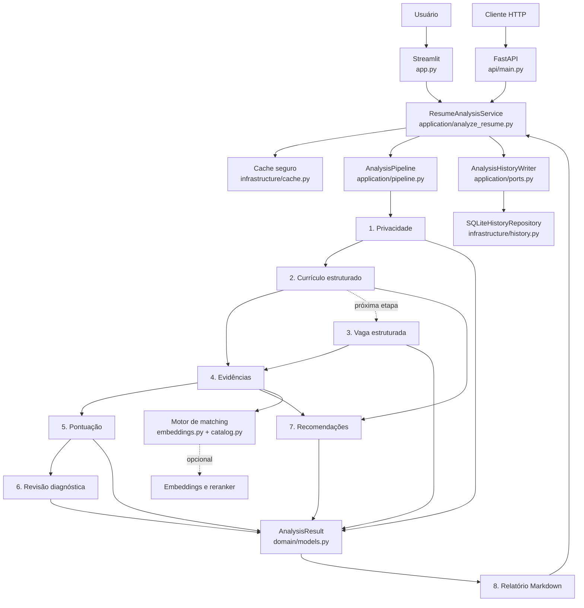

# Arquitetura da V6

## Visão geral

Resume Match AI é um monólito modular local. Streamlit e FastAPI são adaptadores
de entrada independentes e compartilham o mesmo caso de uso. A análise é executada
por uma pipeline sequencial explícita, sem estado global de grafo e sem dependência
de LangGraph.

No código, os oito estágios são chamados nesta ordem: privacidade, estruturação do
currículo, estruturação da vaga, recuperação de evidências, pontuação, revisão,
recomendações e relatório. O currículo e a vaga são preparados em etapas separadas;
ambos são necessários para recuperar evidências. A revisão diagnostica lacunas e
casos limítrofes, sem alterar a nota nem repetir a busca.

## Limites e responsabilidades

- `resume_ai/domain`: modelos Pydantic e regras de pontuação do domínio.
- `resume_ai/application`: caso de uso, pipeline sequencial e portas de persistência.
- `resume_ai/agents`: etapas de domínio pequenas, com resultados e rastros tipados.
- `resume_ai/infrastructure`: parsing, privacidade, embeddings, cache, SQLite,
  correlação, logs e métricas.
- `resume_ai/bootstrap.py`: composição padrão dos agentes e das dependências locais.
- `resume_ai/presentation`: componentes compartilhados de apresentação Streamlit.
- `api`: adaptador HTTP FastAPI, autenticação por chave, limites e erros públicos.
- `app.py`: composição da interface Streamlit; não reimplementa o pipeline.
- `evaluation`: datasets sintéticos, métricas e runners de benchmark.

`ResumeAnalysisService` coordena limites de entrada, cache, execução, histórico e
telemetria. `AnalysisPipeline` contém a ordem dos estágios e monta o resultado. O
conjunto `AnalysisAgents` é injetável no serviço para substituir etapas em integrações
e ambientes de execução sem reescrever a orquestração. A composição padrão fica em
`bootstrap.py`.

As árvores históricas `agents`, `services`, `resume_v4` e `utils` não fazem parte do
pacote distribuído nem da implementação canônica. O empacotamento inclui apenas
`api`, `evaluation` e `resume_ai`, além do módulo `app`.

## Pipeline multiagente

1. **Privacidade:** anonimiza o currículo antes de qualquer embedding.
2. **Currículo:** extrai competências, formação, experiência, projetos e trechos do
   texto anonimizado.
3. **Vaga:** identifica título, requisitos e prioridades.
4. **Evidências:** compara currículo estruturado e vaga. TF-IDF, RapidFuzz e
   cobertura de conceitos compõem o caminho lexical; embeddings e reranker são
   opcionais e têm fallback.
5. **Pontuação:** aplica limiares e pesos por prioridade.
6. **Revisão:** sinaliza requisitos obrigatórios ausentes e resultados próximos dos
   limiares para inspeção humana. Não altera a nota nem repete a recuperação.
7. **Recomendações:** deriva ações das evidências e lacunas encontradas.
8. **Relatório:** produz Markdown; JSON e CSV são serializados pelo serviço.

Todos os estágios usam o executor comum em `resume_ai/agents/base.py`. O `AgentTrace`
registra status, duração, confiança, alertas, referências de evidência e metadados
operacionais. Uma falha preserva sua causa privada para diagnóstico interno e gera
um resultado seguro para logs e adaptadores.

## Matching e fallback

O currículo é dividido em trechos limitados. Para cada requisito, o motor calcula:

- similaridade TF-IDF;
- similaridade aproximada com RapidFuzz;
- cobertura de conceitos e aliases do catálogo local;
- similaridade semântica, quando o modelo de embedding carrega;
- score de CrossEncoder, quando o reranker está habilitado e carrega.

Os embeddings dos trechos são calculados em lote e reutilizados durante a vida da
instância. Se modelo, backend ou inferência falhar, a análise continua pelo caminho
lexical e registra o fallback no estado do motor e nos alertas do agente. O perfil
`demo` não significa “somente lexical”: por padrão ele tenta MiniLM com backend Torch.

## Estado, cache e persistência

Não há estado global de grafo. Cada chamada constrói um `AnalysisResult` tipado. O
cache de resultados usa um hash da versão, configurações e entradas; uma resposta
reutilizada recebe novo `analysis_id` e horário.

O cache padrão é em memória. Cache em disco só é aceito quando
`RESUME_STORE_ANONYMIZED_DOCUMENTS=true`, porque o resultado contém evidências
textuais anonimizadas.

A aplicação depende apenas da porta `AnalysisHistoryWriter`. A implementação padrão,
`SQLiteHistoryRepository`, salva ID, data, perfil, score, nível e um resumo JSON com
score, tempos e flags enumeradas do estado do motor. Currículo, texto integral da
vaga, título inferido, evidências, nomes de modelo e erros de backend não são
persistidos no histórico. A retenção padrão é de 500 entradas; o histórico pode ser
desativado com `RESUME_HISTORY_ENABLED=false`.

## Fronteiras de confiança

- conteúdo enviado é não confiável até passar pela validação de upload e pelo parser;
- texto de currículo é sensível mesmo depois de anonimizado;
- logs aceitam somente eventos e campos enumerados pelo sanitizador;
- `X-Request-ID` recebido é normalizado antes de propagação;
- API key e segredos OIDC pertencem ao ambiente, nunca ao repositório;
- SQLite e caches locais pertencem ao operador da instalação;
- scores são apoio explicável, não decisão automatizada de contratação.

## Pontos de extensão

Novas interfaces devem depender de `ResumeAnalysisService`. Novas implementações de
etapas podem ser agrupadas em `AnalysisAgents` e injetadas sem mudar a sequência da
pipeline. Novos bancos devem implementar `AnalysisHistoryWriter`. Novos retrievers
podem ser colocados atrás do motor de embeddings sem alterar os agentes de score e
relatório. Worker, fila, PostgreSQL e frontend React são evoluções possíveis, mas não
fazem parte da V6.
